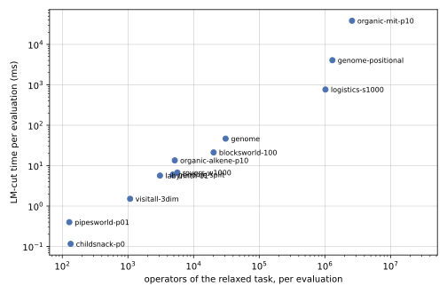

LM-cut for ground and lifted tasks
==================================

``LMCutHeuristic<Kind>`` (``tyr/planning/heuristics/lmcut.hpp``) is LM-cut as Helmert and Domshlak define it
[HD09]_, for ground and for lifted tasks alike. Nothing of the algorithm is relaxed for the lifted case: the
precondition choice function comes from :math:`h^{max}`, every round cuts the justification graph between the
before-goal zone and the goal zone, and the cut's least cost is taken off its actions. What the lifted case adds is
only how the delete relaxation of a state is obtained.

The algorithm
-------------

A state is evaluated in two steps.

1. **Relaxed exploration.** The Datalog engine evaluates the delete-relaxed program of the task
   (``RPGProgram``) on the state, to its fixpoint, with the :math:`h^{max}` annotation policy that records every
   rule instance as an achiever of its heads. A ground task has a rule per ground action; a lifted task has a rule per
   action schema and conditional effect, and the engine enumerates its instances. The result is the same in both
   cases: every fact the state reaches under the delete relaxation, its :math:`h^{max}` value, and every rule instance
   that reaches it.

2. **LM-cut on the relaxed task.** The facts and achievers are turned into an explicit relaxed task
   (``RelaxedTask`` in ``src/planning/heuristics/lmcut.cpp``): facts, operators with their preconditions and effects,
   and for each operator the action it is an instance of. The original algorithm then runs on it without asking the
   engine again:

   - every operator's *supporter* is a precondition of greatest :math:`h^{max}` (the precondition choice function);
   - the *goal zone* is the set of facts that reach the goal over operators of cost 0, through their supporters;
   - the *before-goal zone* is the set of facts the state reaches through supporters outside the goal zone, and the
     *cut* is the set of operators that lead from it into the goal zone;
   - the least cost in the cut is added to the heuristic value and taken off the cut's actions;
   - :math:`h^{max}` is updated incrementally from the operators that got cheaper; an operator keeps its supporter
     unless another precondition is now strictly more expensive;
   - the rounds end when the goal's :math:`h^{max}` is 0.

The operators of one action share its cost. That matters where an action has several rule instances: one per
conditional effect, several for a quantified effect, and in the ground program the applicability rule besides the
effect rules. A cut charges the action once, however many of its operators cross the cut. Where a rule instance is
the only operator of its action (an action without conditional effects), no action binding is looked up at all.

The heuristic value depends on how ties between preconditions of equal :math:`h^{max}` are broken, as in every
implementation of LM-cut. tyr takes the first such precondition in a fixed order of the facts, so values can differ
from those of other planners on tasks with ties; on classical tasks every value is admissible.

Numeric tasks are outside [HD09]_ and are handled differently; see `Numeric tasks`_. Their values are not lower
bounds.

An evaluation allocates no memory once its buffers have the size a state needs, for classical and for numeric tasks,
the engine included: ``tests/unit/planning/heuristics/lmcut.cpp`` counts the allocations of an evaluation after a few
others of the same state, on every fixture task, ground and lifted.

Where the time goes
-------------------

``print_summary`` reports the time an LM-cut heuristic and its workers spent in each phase (the search executables
print it at the default verbosity):

.. list-table::
   :header-rows: 1
   :widths: 20 80

   * - Phase
     - What it measures
   * - Exploration
     - the relaxed exploration of the state by the Datalog engine
   * - Construction
     - the relaxed task built from the engine's facts and achievers
   * - Supporters
     - the relaxed task's adjacency and every operator's supporter
   * - Goal zone
     - per round, the goal zone
   * - Cut
     - per round, the before-goal zone and the cut
   * - Update
     - per round, the costs reduced and :math:`h^{max}` updated

The figures and the table are from a lifted lazy greedy best-first search with LM-cut on tasks of the hard-to-ground
benchmark set (one search worker, one Datalog thread, 60 seconds per task, Intel Core i9-12900KF). The search only
chooses the states; what is shown is the heuristic's own time.

.. figure:: lmcut/phases.svg
   :alt: Share of each phase in the time of LM-cut, per task

   Share of each phase in the time LM-cut takes.

   Time per evaluation against the number of operators of the relaxed task (both axes logarithmic).

.. list-table::
   :header-rows: 1

   * - Task
     - Evaluations
     - Facts
     - Operators
     - Rounds
     - ms per evaluation
     - Exploration
     - Construction
     - Rounds (all)
   * - blocksworld-100
     - 38
     - 10302
     - 20200
     - 3.6
     - 21.23
     - 76%
     - 18%
     - 5%
   * - childsnack-p0
     - 708
     - 36
     - 134
     - 4.8
     - 0.12
     - 80%
     - 16%
     - 4%
   * - genome-positional
     - 15
     - 324
     - 1301370
     - 1.0
     - 4068.65
     - 90%
     - 9%
     - 1%
   * - genome-split
     - 9941
     - 757
     - 4828
     - 21.4
     - 6.00
     - 66%
     - 16%
     - 17%
   * - genome
     - 1287
     - 704
     - 30770
     - 14.2
     - 46.57
     - 70%
     - 19%
     - 11%
   * - labyrinth-01
     - 295
     - 100
     - 3078
     - 4.3
     - 5.67
     - 77%
     - 17%
     - 6%
   * - logistics-s1000
     - 79
     - 11022
     - 1020020
     - 4.0
     - 766.72
     - 75%
     - 20%
     - 5%
   * - organic-alkene-p10
     - 6
     - 62
     - 5171
     - 0.8
     - 13.51
     - 75%
     - 21%
     - 4%
   * - organic-mit-p10
     - 2
     - 397
     - 2589620
     - 2.0
     - 38515.44
     - 87%
     - 10%
     - 3%
   * - pipesworld-p01
     - 11
     - 73
     - 128
     - 3.5
     - 0.40
     - 85%
     - 10%
     - 4%
   * - rovers-w1000
     - 8159
     - 3062
     - 5650
     - 9.4
     - 6.75
     - 74%
     - 15%
     - 11%
   * - visitall-3dim
     - 6
     - 433
     - 1080
     - 2.5
     - 1.51
     - 86%
     - 10%
     - 4%

The last three columns are shares of the heuristic's time: the exploration, the construction, and the four phases of
the rounds together.

The relaxed exploration takes two thirds to nine tenths of the time on every task, and the construction of the relaxed
task most of the rest. The rounds of LM-cut proper are a few percent, and more only where a state needs many rounds
(``genome-split``: 21 per evaluation). The cost of an evaluation follows the number of operators the state reaches
under the delete relaxation: a hundred for ``childsnack-p0`` (0.1 ms), a million for ``logistics-s1000`` (0.8 s) and
``genome-positional`` (4 s), two and a half million for ``organic-mit-p10`` (38 s). On
``organic-synthesis-original/prob01`` the first evaluation does not finish within two minutes.

This is where the generalization from ground to lifted pays: LM-cut needs every operator the state reaches, not only
those on the way to the goal, so the exploration cannot stop at the goal as it does for :math:`h^{max}` and
:math:`h^{FF}`, and its result is the relaxed task grounded for one state. A ground planner pays this once, before the
search; the lifted evaluation pays it per state.

Numeric tasks
-------------

The relaxation of a numeric task keeps, for every function, the interval of the values it can take. It has no finite
fixpoint (a counter that can be increased grows without bound), so the relaxed task of a state cannot be built once.
Instead the engine evaluates :math:`h^{max}` up to the goal in every round, under the costs the earlier cuts left, and
the round's cut is taken by the same code (``RelaxedTask::cut``) on a graph built backwards from the goal: the
:math:`h^{max}`-optimal achievers of that evaluation, one arc from each body atom or numeric support of greatest cost,
over rule instances and interval transitions instead of actions.

The exploration is therefore paid once per round. Lifted A*, 30 seconds, first instance of each IPC 2023 numeric
domain:

.. list-table::
   :header-rows: 1

   * - task
     - evaluations
     - rounds per evaluation
     - ms per evaluation
     - µs per exploration
     - exploration
   * - block-grouping
     - 39197
     - 4.7
     - 0.73
     - 117
     - 91%
   * - counters
     - 2927
     - 2.7
     - 0.12
     - 29
     - 90%
   * - sailing
     - 155
     - 70.7
     - 198.56
     - 2698
     - 97%
   * - tpp
     - 577
     - 2.7
     - 0.26
     - 69
     - 98%
   * - zenotravel
     - 336
     - 6.0
     - 2.08
     - 298
     - 100%

The graphs are small (5 to 340 facts per round); nine tenths and more of the time is the engine deriving intervals
again, and inside it no single step stands out. A numeric evaluation costs about as many :math:`h^{max}` evaluations
as it has rounds. On ``counters``, ``block-grouping`` and ``sailing`` the number of rounds equals the goal's
:math:`h^{max}`: every cut has cost one and the value is :math:`h^{max}` itself. On ``tpp`` and ``zenotravel`` it is
above (2.7 rounds against a mean :math:`h^{max}` of 2.0, and 6.0 against 3.3).

The values are not lower bounds
~~~~~~~~~~~~~~~~~~~~~~~~~~~~~~~

A cut is a landmark only if it holds every operator that leads from the before-goal zone into the goal zone. The
graph of a numeric round does not hold every operator, and an action is not one operator in it. Three tasks under
``tests/docs/lmcut_numeric`` show it, ground and lifted alike, with unit costs (``astar_eager -H lmcut
--search-cost-type unit`` prints the value as the start node's f-value):

.. list-table::
   :header-rows: 1

   * - task
     - LM-cut of the initial state
     - cost of an optimal plan
     - what is missing
   * - ``missing_achiever``
     - 6
     - 3
     - An action that reaches all five goal atoms, but one step later than the five actions that reach one each. It
       is no :math:`h^{max}`-optimal achiever, and an evaluation that stops at the goal never derives it. Five cuts
       of one action each are counted where two actions suffice. A* returns a plan of cost 4.
   * - ``two_effects``
     - 2
     - 1
     - One action adds an atom and increases a function; the goal needs both. The atom's rule instance and the
       interval's transition are cut and paid separately.
   * - ``interval_achiever``
     - 4
     - 3
     - The engine keeps one achiever per interval. A second action reaches the same interval in one step, behind an
       atom the goal needs anyway; it is not in the graph, so the two steps of the first action are counted on top
       of the two actions for the atom.

A sound numeric LM-cut needs three things the present scheme does not have: every achiever of every fact and
interval in the graph, not the cheapest one; an exploration that goes far enough to contain every optimal relaxed
plan (up to the cost of some relaxed plan, which bounds the cost of the optimal one), not one that stops at the goal;
and one cost per application of an action, shared by the rule instances and transitions that one application yields.
With these the explicit relaxed task of the classical case applies and the exploration is paid once per state.
Measured with a cost bound added to the solver for this purpose, one exploration up to twice the goal's cost takes 13%
(``sailing``) to 68% (``tpp``) of what the rounds take now, and up to three times the goal's cost 26% to 97%; the
operators for every combination of intervals come on top.
Admissible landmark-cut heuristics for numeric planning are known for tasks with simple conditions [KSPCB22]_ and
with linear effects [KSB22]_.

The gap in an earlier lifted LM-cut
-----------------------------------

Wichlacz, Höller, Fišer and Hoffmann [WHFH23]_ define a landmark-cut heuristic for lifted planning that avoids
:math:`h^{max}`: lifted atoms are the vertices of a *lifted justification graph*, partially grounded actions label its
edges, and cuts are found by back-chaining from the goal. The paper argues that computing :math:`h^{max}` repeatedly
is infeasible on the lifted level; its variant that does use :math:`h^{max}` has the lowest coverage of its
configurations. The construction treats a lifted atom as one vertex, although its ground instances can lie on both
sides of a cut. This shows in the theory and in the algorithm.

Notation of the paper: a task has one initial atom :math:`\psi_I` and one goal atom :math:`\psi_G`, both ground;
:math:`\mathcal{G}(x)` is the set of ground instances of an atom or action :math:`x`. A lifted justification graph
(Definition 3) has atoms as vertices and edges :math:`s \xrightarrow{l} t` with an action :math:`l`,
:math:`s \in pre(l)` and :math:`t \in add(l)` (C2); :math:`\psi_I` and :math:`\psi_G` are vertices (C1); and (C3) for
every vertex :math:`u` with :math:`\psi_I \notin \mathcal{G}(u)`, every ground action that adds an instance of
:math:`u` is an instance of the label of some edge into :math:`u`.

The theory: Theorem 6
~~~~~~~~~~~~~~~~~~~~~

Theorem 6 states that the labels of every :math:`\psi_I`-:math:`\psi_G`-cut of a lifted justification graph form a
lifted disjunctive action landmark. Its proof rests on Lemma 5: every plan has a corresponding path from the vertex
:math:`\psi_I` to the vertex :math:`\psi_G`. The proof of Lemma 5 walks backwards from the goal and distinguishes two
cases for the current vertex :math:`u`: either :math:`u = \psi_I`, or an edge enters :math:`u` by (C3). But (C3)
exempts every vertex that *covers* the initial atom (:math:`\psi_I \in \mathcal{G}(u)`), not only the vertex
:math:`\psi_I` itself. A lifted vertex that covers :math:`\psi_I` needs no incoming edge and is not :math:`\psi_I`,
so the walk can end there, and the path it has built does not start at :math:`\psi_I`.

A graph that satisfies Definition 3 and refutes the theorem:

- initial atom ``P(d)``, goal atom ``G``, one action ``a(?y)`` with precondition ``P(?y)`` and add effect ``G``;
- vertices ``G``, ``P(?y)`` and ``P(d)``, and the single edge from ``P(?y)`` to ``G`` labeled ``a(?y)``.

(C1) and (C2) hold. (C3) holds for ``G``, and exempts ``P(?y)`` and ``P(d)``, which both cover the initial atom.
The graph has no path from the vertex ``P(d)`` to ``G``, so the empty set is a :math:`\psi_I`-:math:`\psi_G`-cut,
and the theorem makes the empty set a landmark, although the plan ``a(d)`` exists.

The algorithm: line 14 of Algorithm 1
~~~~~~~~~~~~~~~~~~~~~~~~~~~~~~~~~~~~~

Algorithm 1 collects the atoms :math:`P_0` from which the goal is reachable at cost 0 and the actions :math:`A_+`
of positive cost that add an atom of :math:`P_0`. ``FindCut`` then keeps an action of :math:`A_+` in the cut only if
its selected precondition is *not unifiable* with any atom of :math:`P_0`. For a ground precondition that is the
ground rule: an edge that starts inside the goal zone does not cross the cut. For a lifted precondition,
unifiability only says that *some* of its instances lie in the goal zone. The other instances of the partially
grounded action start outside it and cross the cut, and they are dropped with it. The proof sketch of Theorem 10
passes over this step ("clearly disregards only the actions ... that are not necessary").

A task on which the algorithm as printed exceeds the optimal cost:

.. code:: text

   initial atom  I            goal atom  G
   z:        pre P(c)   add G      cost 0
   b:        pre I      add P(c)   cost 10
   i:        pre I      add P(d)   cost 1
   a(?x ?y): pre P(?y)  add P(?x)  cost 1

The optimal plan is ``i``, ``a(c d)``, ``z`` with cost 2. The goal zone is :math:`P_0 = \{G, P(c)\}`; the actions
of positive cost that add ``P(c)`` are ``b`` and ``a(c ?y)``. The precondition ``P(?y)`` of ``a(c ?y)`` is unifiable
with ``P(c)``, so ``a(c ?y)`` is removed, the cut is ``{b}``, and the heuristic value is 10. ``{b}`` is not a
landmark: the optimal plan does not contain ``b``.

``tests/docs/lmcut_gap.py`` implements Algorithm 1 as printed and runs it on this task: it reports the value 10, and
the cost 2 of an optimal plan by uniform-cost search over the ground task. It also checks the graph above.

The implementation published with the paper has the same step (``MyGraph::compute_cut`` in
``src/search/heuristics/landmark_heuristic.cc`` of https://github.com/minecraft-saar/powerlifted drops an edge
whose source atom ``is_unifiable`` with an atom of the goal zone), and the planner shows it. On the task as PDDL
(``tests/docs/lmcut_gap``; unary predicates in place of the nullary ones and of the constants, which that
implementation does not handle), commit ``225c39e`` gives:

.. list-table::
   :header-rows: 1

   * - configuration (``-s astar``)
     - value of the initial state
     - cost of the plan returned
   * - ``-e blind``
     - 1
     - 2
   * - ``-e hmax``
     - 2
     - 2
   * - ``-e landmark -sup ground``
     - 10
     - 10
   * - ``-e landmark -sup initial``
     - 10
     - 10
   * - ``-e landmark -sup random``, ``least``
     - 0
     - 2
   * - ``-e landmark -sup hmax``
     - 1
     - 2

With two of its precondition choices the lifted landmark-cut heuristic returns 10 for a task whose optimal plan costs
2, and A* with it returns the plan ``b``, ``z`` of cost 10.

What a sound version needs
~~~~~~~~~~~~~~~~~~~~~~~~~~

Both problems disappear when a vertex stands for exactly the atoms that are on its side of the cut: an edge may be
left out of the cut only if *every* instance of its source lies in the goal zone, and a vertex may go without incoming
edges only if *every* instance of it holds initially. On ground atoms these are the conditions of [HD09]_. tyr meets
them by cutting the relaxed task of the state, whose vertices are ground facts; the price is the relaxed exploration,
which the measurements above account for.

.. [HD09] M. Helmert and C. Domshlak. Landmarks, critical paths and abstractions: what's the difference
   anyway? ICAPS 2009.
.. [KSB22] R. Kuroiwa, A. Shleyfman and J. C. Beck. LM-cut heuristics for optimal linear numeric planning.
   ICAPS 2022.
.. [KSPCB22] R. Kuroiwa, A. Shleyfman, C. Piacentini, M. P. Castro and J. C. Beck. The LM-cut heuristic family for
   optimal numeric planning with simple conditions. JAIR 75, 2022.
.. [WHFH23] J. Wichlacz, D. Höller, D. Fišer and J. Hoffmann. A landmark-cut heuristic for lifted
   optimal planning. ECAI 2023.
