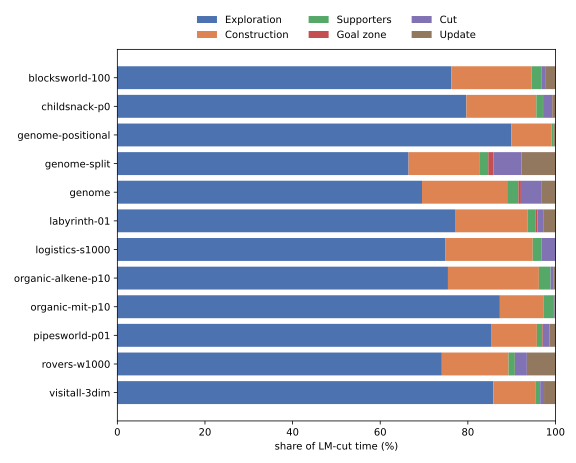

LM-cut for ground and lifted tasks
==================================

``LMCutHeuristic<Kind>`` (``tyr/planning/heuristics/lmcut.hpp``) is LM-cut as Helmert and Domshlak define it
[HD09]_, for ground and for lifted tasks alike. Nothing of the algorithm is relaxed for the lifted case: the
precondition choice function comes from :math:`h^{max}`, every round cuts the justification graph between the
before-goal zone and the goal zone, and the cut's least cost is taken off its actions. What the lifted case adds is
only how the delete relaxation of a state is obtained.

The algorithm
-------------

A state is evaluated in rounds. Each round runs :math:`h^{max}` on the state, cuts the justification graph of that
run, and charges the cut; the rounds end when the goal costs nothing.

1. **h^max.** The Datalog engine evaluates the delete-relaxed program of the task (``RPGProgram``) on the state, to
   its fixpoint, with the costs the earlier cuts of this evaluation charged taken off the actions. It aggregates
   costs by maximum and records every rule instance that reaches a fact as an achiever of it. A ground task has a
   rule per ground action; a lifted task has a rule per action schema and conditional effect, and the engine
   enumerates its instances. The engine does not stop at the goal: a cut needs every arc the state reaches.

2. **The justification graph.** Its vertices are the facts. Every achiever is an arc to its head from its
   precondition choice, the first precondition of greatest :math:`h^{max}`, weighted by its residual cost: its
   cost less that precondition's.

3. **The cut.**

   - the *goal zone* is the first goal fact of greatest :math:`h^{max}`, closed backwards over the arcs of cost 0;
   - the *before-goal zone* is the set of facts the state reaches without entering the goal zone. Only the facts
     the cut asks about are explored: backwards once from the sources of the action arcs into the goal zone, then
     reachability is propagated forwards from the facts of the state, so that cycles do not cut it off;
   - the *cut* is every action arc of positive cost from the before-goal zone into the goal zone;
   - its least residual cost is added to the heuristic value and charged to each action of the cut.

A state from which the goal is unreachable gets an infinite value, and a round without a cut ends the evaluation with
the goal's :math:`h^{max}` added.

The operators of one action share its cost. That matters where an action has several rule instances: one per
conditional effect, several for a quantified effect, and in the ground program the applicability rule besides the
effect rules. A cut charges the action once, however many of its operators cross the cut.

The heuristic value depends on how ties between preconditions of equal :math:`h^{max}` are broken, as in every
implementation of LM-cut. tyr takes the first such precondition in a fixed order of the facts, so values can differ
from those of other planners on tasks with ties; on classical tasks every value is admissible.

Numeric tasks are outside [HD09]_; see `Numeric tasks`_.

An evaluation allocates no memory once its buffers have the size a state needs, for classical and for numeric tasks,
the engine included: ``tests/unit/planning/heuristics/lmcut.cpp`` counts the allocations of an evaluation after a few
others of the same state, on every fixture task, ground and lifted.

Where the time goes
-------------------

``print_summary`` reports how often an LM-cut heuristic and its workers evaluated a state and ran :math:`h^{max}`,
and the time they spent in each phase of an evaluation (the search executables print it at the default verbosity;
``experiments/parser_lmcut.py`` reads it):

.. list-table::
   :header-rows: 1
   :widths: 20 80

   * - Phase
     - What it measures
   * - :math:`h^{max}`
     - per round, the costs the cuts have reduced set on the actions and the relaxed exploration of the state by the
       Datalog engine
   * - Goal zone
     - per round, the goal zone
   * - Before-goal zone
     - per round, the before-goal zone
   * - Cut
     - per round, the cut and its least cost

The figure is from lifted A* with LM-cut and unit costs on the 494 tasks of the hard-to-ground benchmark set that
printed the statistics (one search worker, one Datalog thread, 600 seconds and 8 GiB per task;
``2026-11-12-astar_eager-lifted-lmcut`` in ``experiments/README.md``), the time of each phase summed over the tasks.
``experiments/lmcut_figures.py`` draws it from the evaluation's properties.

   Share of each phase in the time LM-cut takes, summed over all tasks.

Over the 9.1 million evaluations, a state took 8.2 rounds of :math:`h^{max}` and 25 ms on average. The relaxed
exploration takes three fifths of the time and the before-goal zone most of the rest; the goal zone and the cut are
under a twentieth each.

This is where the generalization from ground to lifted pays: LM-cut needs every operator the state reaches, not only
those on the way to the goal, so the exploration cannot stop at the goal as it does for :math:`h^{max}` and
:math:`h^{FF}`, and its result is the relaxed task grounded for one state. A ground planner pays this once, before the
search; the lifted evaluation pays it in every round of every state.

Numeric tasks
-------------

The delete relaxation holds no values of functions: every numeric constraint of a condition is taken to hold, and a
numeric goal is dropped. LM-cut then runs on the facts alone, as above, so the operators a state reaches are finitely
many and every :math:`h^{max}` run reaches its fixpoint. The value is LM-cut of that relaxation and says nothing of
the numeric part of the task.

Admissible landmark-cut heuristics for numeric planning are known for tasks with simple conditions [KSPCB22]_ and
with linear effects [KSB22]_.

The gap in an earlier lifted LM-cut
-----------------------------------

Wichlacz, Höller, Fišer and Hoffmann [WHFH23]_ define a landmark-cut heuristic for lifted planning that avoids
:math:`h^{max}`: lifted atoms are the vertices of a *lifted justification graph*, partially grounded actions label its
edges, and cuts are found by back-chaining from the goal. The paper argues that computing :math:`h^{max}` repeatedly
is infeasible on the lifted level; its variant that does use :math:`h^{max}` has the lowest coverage of its
configurations. The construction treats a lifted atom as one vertex, although its ground instances can lie on both
sides of a cut. This shows in the theory and in the algorithm.

Notation of the paper: a task has one initial atom :math:`\psi_I` and one goal atom :math:`\psi_G`, both ground;
:math:`\mathcal{G}(x)` is the set of ground instances of an atom or action :math:`x`. A lifted justification graph
(Definition 3) has atoms as vertices and edges :math:`s \xrightarrow{l} t` with an action :math:`l`,
:math:`s \in pre(l)` and :math:`t \in add(l)` (C2); :math:`\psi_I` and :math:`\psi_G` are vertices (C1); and (C3) for
every vertex :math:`u` with :math:`\psi_I \notin \mathcal{G}(u)`, every ground action that adds an instance of
:math:`u` is an instance of the label of some edge into :math:`u`.

The theory: Theorem 6
~~~~~~~~~~~~~~~~~~~~~

Theorem 6 states that the labels of every :math:`\psi_I`-:math:`\psi_G`-cut of a lifted justification graph form a
lifted disjunctive action landmark. Its proof rests on Lemma 5: every plan has a corresponding path from the vertex
:math:`\psi_I` to the vertex :math:`\psi_G`. The proof of Lemma 5 walks backwards from the goal and distinguishes two
cases for the current vertex :math:`u`: either :math:`u = \psi_I`, or an edge enters :math:`u` by (C3). But (C3)
exempts every vertex that *covers* the initial atom (:math:`\psi_I \in \mathcal{G}(u)`), not only the vertex
:math:`\psi_I` itself. A lifted vertex that covers :math:`\psi_I` needs no incoming edge and is not :math:`\psi_I`,
so the walk can end there, and the path it has built does not start at :math:`\psi_I`.

A graph that satisfies Definition 3 and refutes the theorem:

- initial atom ``P(d)``, goal atom ``G``, one action ``a(?y)`` with precondition ``P(?y)`` and add effect ``G``;
- vertices ``G``, ``P(?y)`` and ``P(d)``, and the single edge from ``P(?y)`` to ``G`` labeled ``a(?y)``.

(C1) and (C2) hold. (C3) holds for ``G``, and exempts ``P(?y)`` and ``P(d)``, which both cover the initial atom.
The graph has no path from the vertex ``P(d)`` to ``G``, so the empty set is a :math:`\psi_I`-:math:`\psi_G`-cut,
and the theorem makes the empty set a landmark, although the plan ``a(d)`` exists.

The algorithm: line 14 of Algorithm 1
~~~~~~~~~~~~~~~~~~~~~~~~~~~~~~~~~~~~~

Algorithm 1 collects the atoms :math:`P_0` from which the goal is reachable at cost 0 and the actions :math:`A_+`
of positive cost that add an atom of :math:`P_0`. ``FindCut`` then keeps an action of :math:`A_+` in the cut only if
its selected precondition is *not unifiable* with any atom of :math:`P_0`. For a ground precondition that is the
ground rule: an edge that starts inside the goal zone does not cross the cut. For a lifted precondition,
unifiability only says that *some* of its instances lie in the goal zone. The other instances of the partially
grounded action start outside it and cross the cut, and they are dropped with it. The proof sketch of Theorem 10
passes over this step ("clearly disregards only the actions ... that are not necessary").

A task on which the algorithm as printed exceeds the optimal cost:

.. code:: text

   initial atom  I            goal atom  G
   z:        pre P(c)   add G      cost 0
   b:        pre I      add P(c)   cost 10
   i:        pre I      add P(d)   cost 1
   a(?x ?y): pre P(?y)  add P(?x)  cost 1

The optimal plan is ``i``, ``a(c d)``, ``z`` with cost 2. The goal zone is :math:`P_0 = \{G, P(c)\}`; the actions
of positive cost that add ``P(c)`` are ``b`` and ``a(c ?y)``. The precondition ``P(?y)`` of ``a(c ?y)`` is unifiable
with ``P(c)``, so ``a(c ?y)`` is removed, the cut is ``{b}``, and the heuristic value is 10. ``{b}`` is not a
landmark: the optimal plan does not contain ``b``.

The implementation published with the paper has the same step (``MyGraph::compute_cut`` in
``src/search/heuristics/landmark_heuristic.cc`` of https://github.com/minecraft-saar/powerlifted drops an edge
whose source atom ``is_unifiable`` with an atom of the goal zone), and the planner shows it. On the task as PDDL
(with unary predicates in place of the nullary ones and of the constants, which that
implementation does not handle), commit ``225c39e`` gives:

.. list-table::
   :header-rows: 1

   * - configuration (``-s astar``)
     - value of the initial state
     - cost of the plan returned
   * - ``-e blind``
     - 1
     - 2
   * - ``-e hmax``
     - 2
     - 2
   * - ``-e landmark -sup ground``
     - 10
     - 10
   * - ``-e landmark -sup initial``
     - 10
     - 10
   * - ``-e landmark -sup random``, ``least``
     - 0
     - 2
   * - ``-e landmark -sup hmax``
     - 1
     - 2

With two of its precondition choices the lifted landmark-cut heuristic returns 10 for a task whose optimal plan costs
2, and A* with it returns the plan ``b``, ``z`` of cost 10.

What a sound version needs
~~~~~~~~~~~~~~~~~~~~~~~~~~

Both problems disappear when a vertex stands for exactly the atoms that are on its side of the cut: an edge may be
left out of the cut only if *every* instance of its source lies in the goal zone, and a vertex may go without incoming
edges only if *every* instance of it holds initially. On ground atoms these are the conditions of [HD09]_. tyr meets
them by cutting the relaxed task of the state, whose vertices are ground facts; the price is the relaxed exploration,
which the measurements above account for.

.. [HD09] M. Helmert and C. Domshlak. Landmarks, critical paths and abstractions: what's the difference
   anyway? ICAPS 2009.
.. [KSB22] R. Kuroiwa, A. Shleyfman and J. C. Beck. LM-cut heuristics for optimal linear numeric planning.
   ICAPS 2022.
.. [KSPCB22] R. Kuroiwa, A. Shleyfman, C. Piacentini, M. P. Castro and J. C. Beck. The LM-cut heuristic family for
   optimal numeric planning with simple conditions. JAIR 75, 2022.
.. [WHFH23] J. Wichlacz, D. Höller, D. Fišer and J. Hoffmann. A landmark-cut heuristic for lifted
   optimal planning. ECAI 2023.
